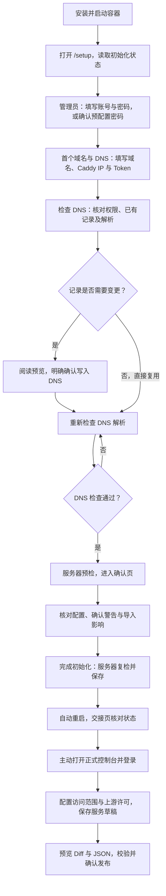

# 初始化流程

本文梳理当前版本的首次初始化，从打开 Setup 到首次发布服务。以默认单容器、内置 Caddy、Cloudflare DNS-01 模式为主；外部 Caddy、配置导入和 Demo 的差异见下文。安装命令见 [README](../README.md#快速部署)，监听与维护边界见[部署与维护](operations.md#初始化与访问边界)。

域名、来源限制与上游许可的完整梳理，以及「初始化默认尽量开放」的修改目标，见[域名与访问策略](domain-access-policy.md)。该方案尚未实施，本文继续描述当前默认值。

## 流程总览

普通 Setup 固定为「管理员 → 首个域名与 DNS → 确认」三步，不填写可信网段或上游许可，不绑定初始化设备。第一个有效提交者成为唯一管理员。

已有记录可复用且解析检查通过时，无需写入或再次检查；图中的解析检查也涵盖这一分支。阻断项修复后才能继续；警告需要明确确认。

## 开始前与默认值

默认内置模式打开 `http://服务器IP/setup`，也可使用 `https://服务器IP/setup`。HTTP 会明文传输手动填写的密码与 Token；HTTPS 初始化可能出现临时证书提示。完成后 HTTP 恢复 HTTPS 跳转。

需要准备可管理的 Cloudflare 域名、实际 Caddy 入口 IP，以及目标 Zone 的 Zone Read、DNS Edit 权限 Token。入口 IP 可以是公网或私网地址，应填写客户端实际访问 Caddy 的地址，不是初始化设备地址。

| 项目 | 普通初始化默认值或规则 |
| --- | --- |
| 管理员用户名 | `admin`，可修改；1–64 字节 |
| 管理员密码 | 手动输入或明确确认预配置密码；至少 8 个 Unicode 字符，最多 256 个 UTF-8 字节 |
| 首个域名 | 接受 `example.com` 或 `*.example.com`，不含协议、端口或路径 |
| 正式控制台 | `https://caddyadmin.example.com` |
| 域名业务访问范围 | 待配置，登录后明确选择 `trusted` 或 `internet` |
| 控制台来源限制 | 关闭；登录后可选启用 LAN/VPN 限制 |
| 可信网段、上游网段和服务名许可 | 空；上游默认不允许 |
| 服务器 DNS | `1.1.1.1`，在高级选项中修改 |
| 浏览器 DNS 查询 | Cloudflare DoH，可切换 Google |
| 初始服务 | 空；显式导入的服务仅保存为草稿 |

Setup 不按来源或 Host 是否私网拒绝访问，实际可达性由端口、监听与防火墙决定。写操作仍要求精确同源 Origin、限速和未初始化状态。

## 环境预配置自动初始化

内置 Caddy、Cloudflare DNS-01 正式模式支持启动时自动初始化。设置以下变量后启动，打开服务器 IP 的 `/setup` 可查看进度；关闭或刷新页面不会取消任务，也不会触发 DNS 写入。

| 变量 | 规则 |
| --- | --- |
| `ADMIN_PASSWORD` | 必需；沿用密码长度校验，仅创建首次管理员 |
| `CLOUDFLARE_API_TOKEN` | 必需；应授予目标 Zone Read、DNS Edit 权限，不回显 |
| `SETUP_DOMAIN` | 必需；基础域名或通配符域名，控制台自动使用 `caddyadmin` 子域 |
| `SETUP_CADDY_IP` | 必需，无默认值；客户端实际访问 Caddy 的 IPv4/IPv6 |
| `SETUP_ADMIN_USERNAME` | 可选，默认 `admin`；1–64 字节 |
| `SETUP_RESOLVERS` | 可选，默认 `1.1.1.1`；逗号分隔的 DNS IP 或 IP:端口 |

入口 IP 不能从 DNS、Host、转发头或外部查询推断。空值或只有空白时进入普通 Setup，必须补充地址；拒绝未指定、回环、链路本地、组播及 IPv4 映射 IPv6 地址，允许明确可访问的私网入口。普通内置正式 Setup 同样不允许地址留空提交。

只有已有目标记录为仅 DNS 且匹配、没有记录冲突或其他地址类型警告、服务器预检无阻断或需确认的警告并通过真实 Caddy 校验时，才自动保存管理员、Token 和仅含控制台的快照。自动流程先通过服务端 Cloudflare DoH 检查解析，再只读核对 Cloudflare 记录，不依赖浏览器在线，也不写 DNS。新建、更新、关闭代理或确认警告仍需要在向导预览并明确确认；任务暂停后保留状态观测页，显示原因与逐项预检详情（通过、警告或阻断、影响及下一步建议），由用户点击「进入向导处理」再打开三步表单；重新读取状态或刷新页面不会自动提交，用户编辑时后台不会继续提交。首次服务列表为空，登录后配置访问属性和上游许可，再校验、明确发布业务。

缺少任一必需变量时沿用三步 Setup，有效的非敏感项会预填。非空无效参数显示错误，完整配置格式错误禁止自动提交；无效凭据须修正或清空并重建容器。不会自动勾选手动流程的凭据、DNS 或警告确认。

已有实例忽略首次参数，不重置密码、不覆盖持久化 Token 或快照。已有意图、未知归属快照或保存结果待核对时停止自动流程，先核对数据，再通过向导接续；不删除数据、不盲目重放。外部 Caddy 和 `TEST_TLS=true` 保持手动流程。预检只读核对 Token 的 Zone 访问及记录；DNS Edit 权限需要部署者授予，真实 DNS 写入与证书签发仍可能因权限不足失败。

进度按检查配置、DoH 解析、凭据与 DNS、服务器预检、保存、重启、等待入口展示，标明已完成、当前需处理与尚未执行，不承诺固定百分比。预检详情展示最近一次检查结果。「重新读取状态」只读缓存；「重新检查 DNS 与预检」会重查 DoH、只读 Cloudflare 记录和服务器预检，即使全部通过也不会保存初始化，须进入向导核对并确认。已初始化、结果待核对、已有提交意图/快照或并发操作时不能重检。初始化已保存与 DNS、证书、浏览器实际可达性分别核对；证书等待或失败不会撤销管理员或再次初始化。

## 第一步：管理员

1. 页面读取初始化状态及凭据配置状态。读取失败显示重试，不把连接失败视为服务正在重启。
2. 填写管理员用户名和密码。若部署已配置 `ADMIN_PASSWORD`，页面只显示状态，须勾选确认使用，不回显密码。
3. 可选展开「从导出的配置初始化」，上传当前 v2 业务配置、预览并点击「采用导入配置」。没有导入时沿用普通默认值。
4. 点击「下一步」进入域名与 DNS。

凭据状态为 `missing` 时手动填写，为 `ready` 时确认使用，为 `invalid` 时须修正或清空部署值并重建容器。重建后旧页面的确认标识失效，需重新读取状态并确认。密码预配置只用于首次初始化，不重置已有账号。

## 第二步：首个域名与 DNS

### 设置访问地址

填写首个域名，核对自动生成的控制台地址，并填写 Caddy 访问 IP。页面可能提供当前访问 IP 建议，但仍需确认它是实际 Caddy 入口；localhost 和外部模式不能依赖该建议。

### 核对凭据与记录

填写 Cloudflare Token，或勾选使用已配置的 `CLOUDFLARE_API_TOKEN`。点击「检查 DNS」后，浏览器先通过所选 DoH 核对控制台和随机一层子域的 A/AAAA；随后服务器只读核对 Token 的域名访问权限与 Cloudflare 记录，即使解析正确也要核对仅 DNS 状态与记录冲突：

- 记录与解析均正确：直接复用；无需 DNS 写入。
- 解析不符且记录需要新增或修改：显示 DNS 变更预览；阅读记录、旧地址与代理状态，勾选影响确认后点击「确认配置」。
- 记录冲突或权限不满足：保留输入并提示原因，修正后重新检查。

目标是 `*.example.com` 的 A 或 AAAA 记录，使用「仅 DNS（灰云）」。确认配置会立即写入 Cloudflare 并读取核对结果，不等待传播。已有记录被覆盖必须明确确认；记录在预览后变化须重新预览。其他地址类型可能影响访问，即使已有记录可复用也须明确确认该警告；记录或指纹变化后重新核对，不自动修改其他记录。

### 检查解析

配置成功后点击「检查 DNS」。浏览器向所选固定 DoH 服务查询控制台域名和随机一层子域的 A/AAAA，核对全部返回地址是否符合目标 IP。没有 AAAA 地址可接受；查询失败、返回非目标地址或完全没有地址时不通过。

未生效时直接重查，或在「查询选项」切换 Google DoH，无需重复写入记录。域名、目标 IP 或 Token 改变后，需要重新核对记录；只更换 DoH 则重新检查解析。

DoH 仅在点击检查时发送域名查询，不发送密码、Token 或网络策略。 自动初始化及观测页显式重检由服务器查询固定 `https://cloudflare-dns.com/dns-query`，同样只发送名称与记录类型，不发送入口 IP、密码或 Token；浏览器手动查询仍可选择 Cloudflare/Google。浏览器 DoH 与「高级：服务器 DNS」相互独立，切换 DoH 不修改服务器设置。DNS 查询通过只表示所选解析器返回正确地址，不代表当前设备可达或 HTTPS 已就绪。

记录已核对且浏览器解析通过后，点击「下一步」执行服务器预检，通过后进入确认页。

## 第三步：确认并保存

核对控制台地址、服务器 DNS、域名和策略。普通初始化明确展示访问范围待配置、控制台来源限制关闭与空上游许可。导入时另核对多域名、网络策略和服务草稿，并确认服务不会自动发布。

预检包含设置有效性、服务器解析器可达性及控制台 DNS；外部模式另检查外部控制台，导入服务时另校验服务。结果分为 `pass`、`info`、`warning`、`block`：控制台服务器 DNS 未返回地址为 `info`，仅作提示，不阻止自动或手动初始化，也不要求确认；解析器不可达仍为警告。阻断不能继续，警告必须勾选确认。证书及正式入口就绪状态在初始化后由交接页面核对。可用「重新预检」读取最新结果。

点击「完成初始化」后，服务器重新检查初始化状态、凭据、设置、导入服务与预检警告。警告确认指纹必须匹配当前结果；变化时保留表单，重新展示并要求确认。

内置非测试模式还会核对 Cloudflare 实际记录和检查或确认指纹，不信任浏览器提交的解析通过标记。最终提交不创建或更新 DNS，也不通过普通服务器 DNS 传播检查强制阻断初始化。

服务器生成不含业务服务的启动配置、保存启动快照，并事务化保存管理员、设置及可选导入草稿。密码仅保存 Argon2id 哈希，Token 写入服务器受限 secret 文件。接口成功返回 `202` 和正式入口地址，随后触发重启；关闭页面不会取消后台操作。

## 重启与正式入口交接

HTTP 页面成功提交后进入 HTTPS 交接页。交接分别展示以下状态：

| 状态 | 含义 |
| --- | --- |
| 初始化已完成 | 管理员和设置已保存 |
| Manager 已响应 | 管理服务可响应状态请求 |
| 服务端 DNS 已有解析结果 | 服务器能查询域名，不等于用户设备解析正确 |
| HTTPS 证书与路由探测通过 | 服务端探测通过，不证明用户设备可达 |
| 用户主动打开正式入口成功 | 当前设备的 DNS、网络和 HTTPS 访问可用 |

交接页提供正式地址、复制与重新核对，并按适用条件提供内置模式临时登录入口。初始化已保存、Manager 正常且 HTTPS 证书与路由探测通过后，自动进入正式控制台；未登录时进入登录页。服务器 DNS 提示不阻止跳转，尚未就绪时保留交接页。内置模式初始化后自动申请证书，签发期间可能仍有临时证书提示。

提交响应丢失时先进入交接核对，不能直接重复提交。只有服务端明确确认未初始化才恢复表单；状态不可读时继续核对。刷新或重新打开页面不会恢复密码和 Token，它们不写入浏览器持久化存储。

## 模式与导入差异

| 场景 | 初始化差异 |
| --- | --- |
| 外部 Caddy | 按[外部模式](operations.md)部署，通过手动 DNS 指引配置记录；本向导不接受或保存远端 Token，不自动向外部实例发布。证书、凭据及正式入口须在专用外部 Caddy 配置；远端不可达不回退内置实例 |
| `TEST_TLS=true` | 仅用于隔离测试；不使用 Cloudflare Token 或自动修改 DNS，使用内部测试 CA，不代表公网可信证书 |
| v2 配置导入 | 同样三步，导入域名、策略和服务草稿，不导入凭据；导入的控制台来源限制只保留待发布，初始化运行状态仍关闭。非标准控制台标签、Origin 端口、未完成地址交接与旧 v1 文件明确拒绝 |
| 静态 Demo | `make web-demo` 启动后点击「体验初始化」；DNS、证书及重启仅模拟，完成后主动进入演示控制台，不作为真实部署验收 |

## 失败与重试

| 情况 | 影响与下一步 |
| --- | --- |
| 状态读取失败 | 尚不能确认初始化状态；检查服务与网络并重试，曾提交时先使用 HTTPS 交接页核对 |
| DNS 预览后记录变化 | 确认失效；重新预览并明确确认，不能静默覆盖 |
| DNS 查询未通过 | 保留输入；核对记录、缓存和网络，切换 DoH 或稍后重查，不重复写入 |
| 预检阻断或警告变化 | 修正阻断项，或读取最新警告并重新确认 |
| 后台 503 | 保留当前页面输入，检查服务与存储后重试；不要刷新丢失手动凭据 |
| `setup_local_persistence` | DNS 已配置但本地初始化未完成；保留数据、修复存储，重新预览提交；不会自动撤销外部 DNS |
| 提交结果未知 | 先核对实际状态，不自动重放完成请求 |
| 检测到已有启动快照 | 保护数据并拒绝覆盖；按运维文档核对实例或恢复，不删除数据库或快照绕过失败 |
| 正式入口打不开 | 分别检查本机 DNS、LAN/VPN 路由、防火墙和证书状态；服务端探测通过不保证本机可达 |

## 初始化后的核心任务

登录后先配置域名访问范围与上游许可，再新增服务。服务新增、修改、启停和删除仅改变草稿；导入草稿也不自动上线。

沿用「保存服务草稿 → 查看业务 Diff 和只读 JSON → 校验配置 → 明确确认发布」。LAN/VPN 控制台限制是可选项，相关设置按草稿与发布流程生效。详细操作见[使用指南](usage.md)。

## 实现与接口索引

- [Setup 页面](../web/src/pages/Setup.tsx)、[交接页面](../web/src/components/SetupHandoff.tsx)：三步交互、保留输入和结果核对。
- [初始化用例](../internal/application/setup.go)、[DNS 确认用例](../internal/application/setup_dns.go)：规范化、预检、保存与恢复保护。
- [Setup HTTP 接口](../internal/adapter/httpapi/setup.go)、[API 文档](api.md)：状态、预检、DNS 预览/确认和完成接口。`/setup/dns/check` 是服务器解析器诊断入口，向导的浏览器 DoH 检查不调用它。
- [验证边界](verification.md)：演示与接口检查不能替代真实 Caddy 和容器验收。
