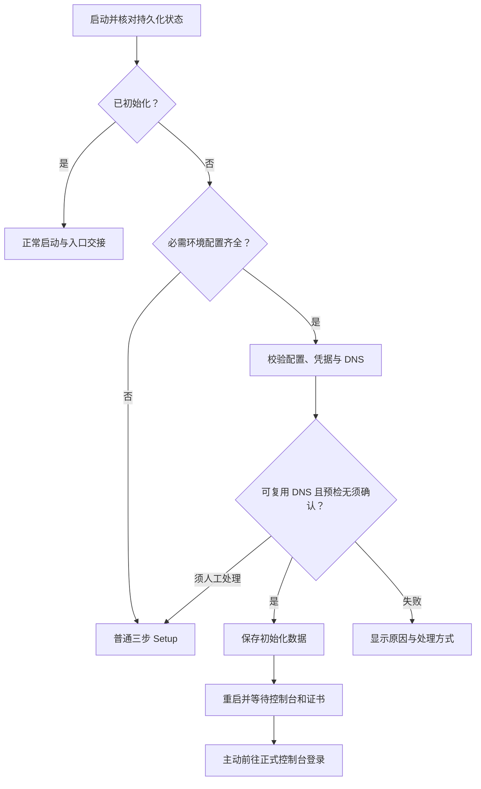

# 环境变量预配置与自动初始化设计

状态：待审阅，尚未实现。本文描述新增行为，不代表当前版本已支持。

## 用户意图与范围

部署者希望把首次初始化所需信息放在 Compose 的 `environment` 中，启动后由服务端完成初始化，打开服务器 IP 即可查看进度，不必再次填写三步表单。

沿用单实例、单管理员、专用 Caddy 和现有持久化目录。普通手动 Setup 保留。本次只设计内置 Caddy、Cloudflare DNS-01 正式模式的自动初始化。
外部 Caddy 和 `TEST_TLS=true` 继续走现有流程，不自动加载远端配置。

本文补充并替代[多域名管理与精简初始化设计](2026-10-03-managed-domains-design.md)中“预配置凭据必须在页面确认后才能初始化”的对应规则：满足本设计的完整配置条件时，部署配置本身授权创建首次管理员、保存 Token 和生成仅含控制台的启动配置。需要修改 DNS 或确认预检警告时仍须明确确认。业务发布流程和认证要求不变。

## 当前实现

- `ADMIN_PASSWORD` 和 `CLOUDFLARE_API_TOKEN` 已支持 Compose 明文配置或环境变量、`.env` 注入；当前 Setup 只显示配置状态，要求确认使用。
- 当前没有读取首个域名、入口 IP 和 Setup 服务器 DNS 的环境变量，也没有启动时自动初始化流程。
- 当前手动流程包含 DNS 核对、必要时的变更预览与确认、服务器预检、保存、重启和正式入口交接。自动路径复用这些业务用例，不另写一套安全规则。
- 实现参考：[部署配置](../../../internal/config/config.go)、[初始化用例](../../../internal/application/setup.go)、[DNS 用例](../../../internal/application/setup_dns.go)、[当前流程说明](../../setup.md)。

## 参数与默认值

| 环境变量               | 必需性与默认值       | 语义                                                                          |
| ---------------------- | -------------------- | ----------------------------------------------------------------------------- |
| `ADMIN_PASSWORD`       | 自动路径必需         | 创建首次管理员，沿用现有密码校验；不重置已有账号                              |
| `CLOUDFLARE_API_TOKEN` | 自动路径必需         | 核对目标 Zone 的 Zone Read、DNS Edit 权限，成功初始化后按现有规则持久化       |
| `SETUP_DOMAIN`         | 自动路径必需         | 首个基础域名，允许 `example.com` 或 `*.example.com`，沿用现有规范化           |
| `SETUP_ADMIN_USERNAME` | 可选，默认 `admin`   | 沿用现有用户名规则                                                            |
| `SETUP_CADDY_IP`       | 自动路径必需，无默认值 | 必须明确填写客户端实际访问 Caddy 的 IPv4 或 IPv6，不得为空                    |
| `SETUP_RESOLVERS`      | 可选，默认 `1.1.1.1` | 逗号分隔的服务器 DNS 地址，沿用现有 IP 或 IP:端口校验；不替代系统的上游解析器 |

入口 IP 必须由部署者明确提供，不从已有 DNS、浏览器来源、Host、转发头或外部 IP 查询服务推断；不默认使用 `0.0.0.0` 或 `::`，明确拒绝这些未指定地址。手动 Setup 同样必须填写或明确确认有效入口 IP，不能留空提交。

控制台域名自动生成 `caddyadmin.<基础域名>`。首个域名业务访问属性为待配置，控制台来源限制关闭，可信网段与上游许可为空，服务列表为空；首次登录后再配置业务并明确发布。

## 启动判定与授权

1. 先读取数据库及初始化恢复状态。已有实例直接正常启动，忽略首次初始化参数，不更改密码、业务设置、运行 Token 或快照。
2. 数据库不可读、版本不支持、已有快照归属不明或上次提交结果待核对时，先报错或执行现有核对流程；不能当作新实例，不删除数据绕过问题。
3. 未初始化且 `ADMIN_PASSWORD`、`CLOUDFLARE_API_TOKEN`、`SETUP_DOMAIN`、`SETUP_CADDY_IP` 四个必需参数均非空时，进入自动预检；参数格式或凭据无效则显示失败原因，禁止提交。
4. 必需参数缺失时进入普通三步 Setup。有效的预配置域名、用户名、入口 IP 和服务器 DNS 可预填；密码与 Token 继续只显示状态并按手动流程确认使用。
5. 入口 IP 缺失或仅含空白时不进入自动预检，转入普通 Setup 要求补充；已有 DNS 记录不能代替入口 IP 输入。需要外部变更确认或警告确认时暂停自动提交。

自动流程由服务启动触发，在后台串行运行；访问或刷新页面只读取状态，不触发初始化或外部写入。完整部署配置是首次初始化授权，但不是覆盖 DNS、重置已有实例或发布业务服务的授权。

## DNS 复用与确认

自动路径读取 Cloudflare 目标 Zone 记录，并复用现有记录冲突检查，不依赖浏览器 DoH 才能推进。核对真实记录不等于 DNS 已传播，也不等于客户端已经能访问入口。

| 条件                                                                     | 处理                                                                             |
| ------------------------------------------------------------------------ | -------------------------------------------------------------------------------- |
| 提供入口 IP，现有目标记录为仅 DNS 且匹配，其他相关记录无冲突             | 直接复用，继续自动初始化，不写 DNS                                               |
| 提供入口 IP，需要新增记录、修改地址或关闭代理                            | 暂停并展示现有 DNS 预览，必须明确确认后写入                                      |
| 未提供入口 IP                                                           | 不执行自动 DNS 核对，进入普通 Setup 要求填写入口 IP                              |
| 存在 CNAME、重复记录、代理状态不符、控制台精确记录冲突等                 | 暂停并解释原因，沿用现有冲突处理；不擅自覆盖或删除                               |
| Token 无效、权限不足或 Cloudflare 不可达                                 | 显示失败或可重试状态，不生成“DNS 已核对”的结果                                   |

有效地址至少满足现有 Setup IP 校验，并排除未指定、回环、链路本地和组播地址；允许明确可访问的私网入口。复用公共 DNS 的私网地址不能被解释为公网可达。

暂停后的处理沿用手动 Setup：输入缺失信息、预览、确认、检查解析和最终确认。自动路径不增加 DNS 自动覆盖环境开关。确认绑定服务端生成的预览与指纹，记录变化必须重新核对、预览和确认。

## 预检、保存与恢复

自动路径执行与手动 Setup 等价的服务器校验：凭据、业务设置、DNS 记录、服务器 DNS、真实 Caddy 和快照保护。无阻断、无须确认的警告且 DNS 可只读复用时，自动保存；出现警告则暂停，沿用警告指纹确认，不默认勾选。

复用现有初始化用例、实例锁、初始化串行锁和持久化保护；启动任务与手动提交不能创建两个管理员或并行覆盖快照。进入需人工处理状态后停止自动提交，由手动流程接续，不能在用户编辑时后台抢先完成。

保存成功后生成仅含控制台的启动配置，持久化管理员与 Token，重启并进入现有入口交接。初始化已保存、Manager/Caddy 就绪、DNS 状态、证书状态和浏览器实际可达性分别展示。证书申请失败不撤销已创建管理员，也不重新初始化。

重启、提交响应丢失或页面断联后，先核对持久化初始化状态、意图和快照，再决定继续、等待或提示处理；结果未知时禁止盲目重放。DNS 已修改但本地保存失败时说明实际影响，不自动回滚 DNS。不得删除真实运行数据作为重试手段。

## IP 页面与错误交互

打开 IP 入口时，根据服务端状态展示普通 Setup、初始化进度、需要处理的步骤或交接结果。进度使用已有状态查询方式，不要求新增 WebSocket。



进度页展示“检查配置 → 核对凭据与 DNS → 保存初始化数据 → 重启服务 → 等待正式入口”。状态区分运行中、需要输入/确认、失败、结果待核对、初始化已保存和正式入口就绪。不承诺固定完成百分比；关闭页面不取消后台任务。

公开的 IP 状态接口只提供必要阶段、脱敏错误和既有交接所需信息，不返回环境变量原值、凭据、上游信息、服务器 DNS 列表或内部路径。需要人工处理时沿用现有 Setup 接口和精确 Origin、限速保护，不能通过匿名重试按钮直接修改环境变量或越过 DNS/警告确认。

浏览器不持久化凭据，日志和审计不输出密码、Token 或包含敏感内容的模块原始日志。自动路径不需要在浏览器重新传输预配置密码或 Token；手动 HTTP 输入仍保留明文传输提示。管理 API 继续要求现有认证、CSRF 和 Cookie 保护。

## 配置示例（拟新增，当前不可用）

```yaml
environment:
  ADMIN_PASSWORD: ${ADMIN_PASSWORD:-}
  CLOUDFLARE_API_TOKEN: ${CLOUDFLARE_API_TOKEN:-}
  SETUP_DOMAIN: example.com
  SETUP_CADDY_IP: 203.0.113.10 # 自动初始化必填；文档示例地址，替换为真实入口 IP。
  # SETUP_ADMIN_USERNAME: admin
  # SETUP_RESOLVERS: 1.1.1.1
```

凭据可直接配置或通过环境变量、`.env` 注入，不提交真实凭据到版本控制。使用空值默认保留无预配置的手动部署方式，不通过 Compose 强制要求所有部署者提供自动初始化参数。

## 验收与文档同步

- 完整配置、有效既有 DNS、无确认警告：无需填表或点击完成，打开 IP 可观察进度并最终前往登录。
- 缺失必需参数：普通三步 Setup，非敏感预配置项可预填；非空无效配置明确报错。
- 入口 IP 缺失、空字符串或仅含空白时不启动自动初始化，即使已有唯一有效 DNS 记录也必须补充；手动 Setup 不允许入口 IP 留空提交。有效 IPv4/IPv6 按明确提供的地址核对 DNS；无记录、双栈、CNAME、重复、橙云及精确记录冲突沿用现有规则处理；`0.0.0.0` 和 `::` 明确拒绝。
- 自动流程不写 DNS；必要变更转入明确确认，记录及警告指纹变化不沿用旧确认。
- 覆盖启动任务与手动提交竞争、刷新页面、关闭页面、断联、重启和写入失败；最多创建一个管理员，结果未知先核对，已有数据不被覆盖。
- 初始化后环境参数变化不重置密码、不覆盖运行 Token、不修改已生效配置；已有实例不因首次参数无效而无法启动。
- API、页面、日志、审计和业务导出不泄露凭据；未认证管理请求仍被拒绝。证书等待或失败不误报公网可信或浏览器可达。
- 内外模式、测试模式、无预配置和部分预配置仍保留原有行为；初始服务列表为空，业务上线仍须校验和明确发布。
- 实现时按影响范围补充 Go/API、前端及 mock 测试，并通过隔离真实 Caddy 和容器验证首次自动初始化及重启恢复，不使用生产凭据或部署。
- 实现时同步 README、`docs/setup.md`、usage、api、operations、verification、Compose 示例及 AGENTS.md 的 Setup 对应规则；本次只新增 spec，不把拟议参数写成当前已支持功能。
